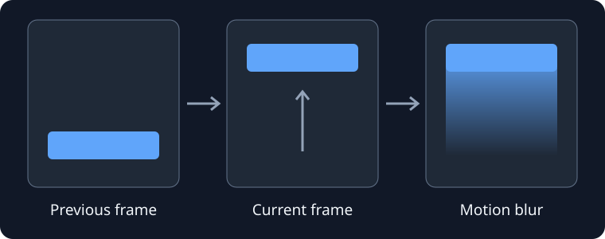
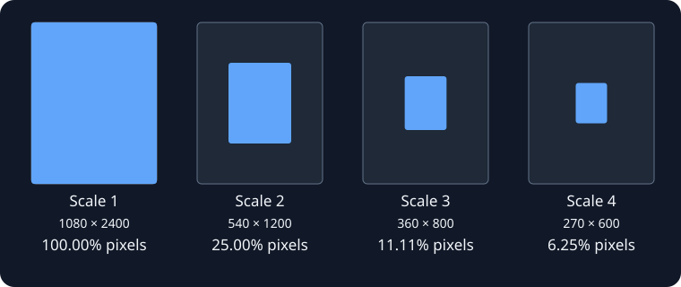

<p align="center">
  
  
  
</p>

# Skia Motion Blur

---

## What is Skia Motion Blur?

**Skia Motion Blur** is a system module that adds motion blur to eligible frames during scrolling and transitions. Its appearance depends on how the content is rendered and the device.

The module does not generate new frames or increase the frame rate (FPS).

The project's name was inspired by the **Skia** graphics library used in Android. However, the current implementation operates within `SurfaceFlinger` without directly hooking the Skia library.

<p align="center">
  
</p>

## How Skia Motion Blur Works

The module operates within `SurfaceFlinger` and compares consecutive images from an eligible rendering output to estimate the direction and magnitude of motion, then adds blur to that output.



To learn more about how it works and the processing stages, see [How Skia Motion Blur works](docs/how_skia_motion_blur_works.md).

## Features

- Motion blur during scrolling and transitions.
- System-level graphics processing.
- Customize the effect, processing resolution, and application selection at runtime.

### When does the effect appear?

Having an allowed application alone is not enough; the effect requires an eligible rendering output and motion that can be estimated between two consecutive images. Touch input briefly increases the effect's sensitivity to subtle motion, but it is not required for the effect to appear.

## Requirements and Compatibility

| Requirement | Support |
|---|---|
| Android | 12–16 |
| Magisk | 26 or newer |

> [!NOTE]
> The installer also supports KernelSU and APatch when system-level module mounting is available.
>
> Zygisk is not required.

The effect requires an OpenGL ES 3-compatible rendering output; support for the Android version or root manager alone does not guarantee that the effect will appear.

### Why Android 12 and above?

Support is limited to Android 12–16 according to the module's compatibility policy, as the compatibility and stability of the implementation on older versions have not been verified.

### Version Compatibility

| Version | EGL Strategy |
|---|---|
| Android 12–13 | EGL KHR |
| Android 14–16 | EGL KHR and EGL 1.5 |
| Outside Android 12–16 | Not supported |

Compatibility may vary depending on the device's `SurfaceFlinger` implementation and graphics drivers.

## Installation

> [!CAUTION]
> ### Warning Before Installation
>
> The module operates within the `SurfaceFlinger` process and may cause a **Bootloop** on incompatible devices or ROMs.
>
> **It is strongly recommended to install a Bootloop Protector module before installing Skia Motion Blur.**

### Installation Steps

1. Download the latest ZIP file from the [Releases page](https://github.com/YasserNull/skia-motion-blur/releases).
2. Open your root manager.
3. Install the module from the ZIP file.
4. Reboot your device.

## Settings

The effect can be customized through the `skia-motion-blur.prop` file located inside the module directory.

**Magisk and APatch**

```text
/data/adb/modules/skia-motion-blur/skia-motion-blur.prop
```

**KernelSU**

```text
/data/adb/ksu/modules/skia-motion-blur/skia-motion-blur.prop
```

Changes are usually applied within a few seconds without requiring a device reboot.

### Default Settings

```properties
enabled=1
strength=8.0
exposure_ms=8.333
log=0
debug=0
allow_packages=*
history_scale=1
history_timeout_ms=150
memory_limit_mb=128
```

### Settings Explained

| Setting | Description | Values |
|---|---|---|
| `enabled` | Enable or disable the effect | `0` or `1` |
| `strength` | Motion blur strength | `0–8` |
| `exposure_ms` | Exposure duration in milliseconds | `1–50` |
| `log` | Log diagnostic information | `0` or `1` |
| `debug` | Diagnostic mode and disabling effect cleanup requests after motion | `0` or `1` |
| `allow_packages` | Applications allowed to activate the effect | `*` or package names |
| `exclude_packages` | Applications excluded from the effect | Package names |
| `history_scale` | Resolution used for motion estimation and blur calculation | `1–4` |
| `history_timeout_ms` | Maximum time interval between two frames for motion calculation | `16–250` |
| `memory_limit_mb` | Maximum memory for processing images per rendering context in megabytes | `8–128` |

Increasing `strength` makes the blur stronger. Increasing `exposure_ms` may make motion trails longer. Using `strength=0` disables the effect.

### `history_scale` Levels



| Value | Width and Height Resolution | Pixel Count Percentage | Expected Effect |
|---|---:|---:|---|
| `1` | 100% | 100% | Highest detail and highest resource usage |
| `2` | 50% | 25% | Balance between quality and performance |
| `3` | 33.3% | 11.1% | Low resource usage |
| `4` | 25% | 6.25% | Lowest expected resource usage and less detail |

When using a value higher than `1`, blur is calculated at a lower resolution, then the resulting difference is blended with the original image at the output resolution.

> [!NOTE]
> This setting does not change the screen resolution. The percentages represent the size of the processing images, not actual performance measurements.

### Application Selection

To enable the effect for all applications:

```properties
allow_packages=*
```

To enable it only for specific applications:

```properties
allow_packages=com.android.settings,com.example.app
```

To exclude specific applications:

```properties
allow_packages=*
exclude_packages=com.example.app
```

> [!NOTE]
> Application selection determines when the effect is allowed to activate. It does not isolate the application's layer from the other elements of the composited image.

## Logs

To enable logging:

```properties
log=1
```

To view the module logs:

```sh
logcat -s SkiaMotionBlur
```

## Building from Source

### Requirements

- Python 3
- Android NDK
- LLVM / Clang
- CMake for running tests

### Building the Module

```sh
python3 tools/build_runtime.py --ndk /path/to/ndk/version
```

The package is generated at:

```text
release/skia-motion-blur-<version>.zip
```

## Tests

```sh
cmake -S . -B build/host
cmake --build build/host
ctest --test-dir build/host --output-on-failure
python3 -m unittest discover -s tests
```

> [!NOTE]
> Actual rendering tests require a suitable Android environment.

## Contributing

Contributions, bug reports, and compatibility testing are welcome:

- [Report an issue](https://github.com/YasserNull/skia-motion-blur/issues)
- [Pull requests](https://github.com/YasserNull/skia-motion-blur/pulls)

## License

The project is licensed under the [GPLv3](LICENSE).

## Donate

You can support the project via [Ko-fi](https://ko-fi.com/yassernull).