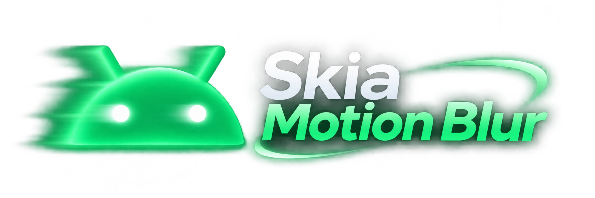

# Skia Motion Blur



<p align="center">
  
  
  
</p>

<p align="center">
  <strong>ضبابية حركة متقدمة لنظام أندرويد.</strong>
</p>

---

## ما هي Skia Motion Blur؟

**Skia Motion Blur** وحدة روت مفتوحة المصدر لنظام أندرويد، تضيف تأثير ضبابية الحركة (Motion Blur) إلى واجهة النظام والتطبيقات والألعاب، لجعل الحركة أكثر سلاسة بصريًا.

تعمل الوحدة داخل عملية `SurfaceFlinger`، وتعترض مسارات الرسم المدعومة عبر `EGL/OpenGL ES` لتقدير الحركة بين الإطارات وتطبيق ضبابية اتجاهية على خرج تركيب الإطارات المؤهل.

### لماذا سُمّيت Skia Motion Blur؟

استُوحي الاسم من مكتبة الرسوميات **Skia** المستخدمة في أندرويد. لكن التنفيذ الحالي لا يعترض مكتبة Skia مباشرةً؛ بل يعمل داخل `SurfaceFlinger`.

## How Skia Motion Blur Works

تقوم **Skia Motion Blur** بحقن مكتبة أصلية داخل عملية `SurfaceFlinger` في أندرويد باستخدام `LD_PRELOAD`. وتعترض مسارات الرسم المدعومة عبر `EGL/OpenGL ES`، وتحلل الحركة بين الإطارات المتتالية، ثم تطبّق ضبابية حركة اتجاهية على خرج تركيب الإطارات المؤهل.

لشرح تفصيلي لآلية الحقن وخوارزمية تقدير الحركة ومراحل المعالجة وحدود التوافق، راجع [How Skia Motion Blur Works](docs/how_skia_motion_blur_works.md).

## المميزات

- **حركة أكثر سلاسة بصريًا:** إضافة ضبابية الحركة أثناء التمرير والتنقل بين التطبيقات، وحركات واجهة النظام والألعاب.

## المتطلبات والتوافق

| المتطلب | الدعم |
|---|---|
| إصدار أندرويد | Android 12–16 |
| مستوى API | 31–36 |
| واجهة الرسوميات | OpenGL ES 3 |
| Magisk | الإصدار 26 أو أحدث |
| KernelSU | مدعوم |
| APatch | مدعوم |
| Zygisk | غير مطلوب |

### لماذا Android 12 فما فوق؟

يستهدف التنفيذ الحالي واجهات ومسارات `SurfaceFlinger` و`EGL` ضمن API 31–36. تختلف تفاصيل التنفيذ في الإصدارات الأقدم، لذلك يرفض المثبّت الإصدارات الأقل من Android 12. لا يعني ذلك استحالة دعمها مستقبلًا.

### توافق الإصدارات

| الإصدار | استراتيجية EGL |
|---|---|
| Android 12–13 | EGL KHR |
| Android 14–16 | EGL KHR وEGL 1.5 |
| خارج API 31–36 | غير مدعوم |

قد يختلف التوافق الفعلي بين الأجهزة والرومات بحسب تنفيذ `SurfaceFlinger` وتعريفات الرسوميات وآلية تركيب ملفات الوحدة.

## التثبيت

### تحذير قبل التثبيت

تعمل الوحدة داخل عملية `SurfaceFlinger`، وقد تتسبب في حدوث **Bootloop** على بعض الأجهزة أو الرومات غير المتوافقة.

**يُنصح بشدة بتثبيت وحدة Bootloop Protector قبل تثبيت Skia Motion Blur.** قد تساعد في الاسترداد عند حدوث مشكلة، لكنها لا تضمن التعافي في جميع الحالات.

### خطوات التثبيت

1. نزّل أحدث ملف ZIP من [صفحة الإصدارات](https://github.com/YasserNull/skia-motion-blur/releases).
2. افتح مدير الروت: Magisk أو KernelSU أو APatch.
3. ثبّت الوحدة من ملف ZIP.
4. أعد تشغيل الجهاز.
5. عدّل ملف إعدادات الوحدة حسب رغبتك.

## الإعدادات

يستخدم المشروع ملف `skia-motion-blur.prop` بصيغة `key=value` داخل مجلد الوحدة.

### الإعدادات الافتراضية

```properties
enabled=1
strength=3.0
exposure_ms=16.667
temp_settings=1
log=0
debug=0
allow_packages=*
history_scale=4
history_timeout_ms=150
memory_limit_mb=48
```

### شرح الإعدادات

| المفتاح | الوصف | القيم |
|---|---|---|
| `enabled` | تشغيل التأثير أو إيقافه | `0` أو `1` |
| `strength` | قوة ضبابية الحركة | `0–8` |
| `exposure_ms` | مدة التعريض بالملّي ثانية | `1–50` |
| `temp_settings` | مراقبة تغييرات الإعدادات دوريًا | `0` أو `1` |
| `log` | تفعيل سجلات التشخيص | `0` أو `1` |
| `debug` | عرض معلومات تصحيح التأثير | `0` أو `1` |
| `allow_packages` | التطبيقات المسموح بها | `*` أو أسماء الحزم |
| `history_scale` | دقة الإطارات المستخدمة لتقدير الحركة | `1–4` |
| `history_timeout_ms` | مهلة صلاحية الإطار السابق | `16–250` |
| `memory_limit_mb` | الحد التقديري لذاكرة قوام التأثير لكل سياق رسم | `8–128` |
| `quality` | مستوى الجودة الاختياري | `low` أو `balanced` أو `high` |

### مستويات الجودة

| الجودة | القيمة | دقة التاريخ | استهلاك الموارد |
|---|---|---|---|
| `low` | `history_scale=4` | ربع العرض والارتفاع | أقل |
| `balanced` | `history_scale=2` | نصف العرض والارتفاع | متوسط |
| `high` | `history_scale=1` | الدقة الكاملة | أعلى |

مثال:

```properties
quality=balanced
```

### تحديد التطبيقات

لتفعيل التأثير مع جميع التطبيقات:

```properties
allow_packages=*
```

لتفعيله مع تطبيقات محددة فقط:

```properties
allow_packages=com.android.settings,com.android.launcher3
```

### تحديث الإعدادات

عند ضبط `temp_settings=1`، يعيد المتحكم قراءة ملف الوحدة كل خمس ثوانٍ تقريبًا، وتفحص مكتبة التأثير النسخة الداخلية أثناء الرسم كل ثانية تقريبًا.

عند ضبط `temp_settings=0`، لا يراقب المتحكم التغييرات دوريًا بعد التهيئة. يُختار هذا النمط عند بدء المتحكم، لذلك يتطلب تغيير `temp_settings` نفسه إعادة بدء المتحكم.

## الأداء والقيود

- تتطلب المعالجة مسار `OpenGL ES 3` ومخرج رسم مؤهلًا.
- لا يوجد اعتراض لمسار Vulkan داخل `RenderEngine`.
- لا تدعم الوحدة المحتوى المحمي أو مخارج HDR.
- يقبل المرشح مخارج القوام المتوافقة بصيغتي `R8G8B8A8_UNORM` و`R8G8B8X8_UNORM`، وبأبعاد لا تقل عن `256×256`، وفق شروط الرسم الأخرى.
- قد تؤدي الأنماط المتكررة أو الحركة المعقدة إلى أخطاء في تقدير الحركة.
- قد تزيد الوحدة استهلاك GPU والذاكرة والطاقة، ولا تضمن زيادة FPS.

### استهلاك الذاكرة

يحدد `memory_limit_mb` الحد التقديري لذاكرة القوام لكل سياق رسم. ويعتمد التقدير على أبعاد الشاشة وقيمة `history_scale`:

```text
hw = ceil(width / history_scale)
hh = ceil(height / history_scale)

estimated_bytes =
    4
    + 8 * hw * hh
    + 4 * ceil(hw / 16) * ceil(hh / 16)

if history_scale > 1:
    estimated_bytes += 4 * width * height
```

لا يشمل هذا التقدير بالضرورة جميع الموارد الداخلية لتعريف الرسوميات.

## التشخيص وحل المشكلات

لتفعيل السجلات:

```properties
log=1
```

لعرض سجلات الوحدة:

```sh
su -c 'logcat -d -s SkiaMotionBlur'
```

لعرض الحالة:

```sh
su -c 'cat /data/misc/skia-motion-blur/skia-motion-blur.status'
```

### حالات التشغيل

| الحالة | المعنى |
|---|---|
| `invalid-config` | إعدادات غير صالحة |
| `config-copy-failed` | فشل نشر إعدادات التشغيل |
| `inactive-foreground` | التطبيق الأمامي غير مؤهل أو التأثير غير نشط |
| `armed-awaiting-gles-output` | انتظار مخرج GLES مؤهل |
| `gles-output-detected` | اكتشاف مخرج GLES مناسب |
| `no-eligible-gles-output` | لم يُكتشف مخرج مناسب خلال المهلة |
| `unsupported-composition-control` | تعذّر تأكيد التحكم بتركيب العرض |

قد تتوفر ملفات تشخيص إضافية داخل:

```text
/data/adb/modules/skia-motion-blur/
/data/misc/skia-motion-blur/
```

ومنها `boot-error.txt` و`stock-source.txt` و`loader-probe.txt` و`skia-motion-blur.launches`.

راجع [VALIDATION.md](VALIDATION.md) لمزيد من تفاصيل التحقق والاختبار.

## البناء من المصدر

### المتطلبات

- Python 3
- Android NDK
- LLVM / Clang
- CMake لتشغيل الاختبارات

### بناء الوحدة

```sh
python3 tools/build_runtime.py --ndk /path/to/android-ndk
```

تُنشأ الحزمة في:

```text
release/skia-motion-blur-<version>.zip
```

يستخدم المشروع C11 وتحسينات `-O2`، ويستهدف API 31 كحد أدنى. تتضمن الحزمة ملف `binaries.sha256.json` لبصمات الملفات الثنائية.

## بنية المشروع

| المسار | الوظيفة |
|---|---|
| `src/runtime/hooks.c` | اعتراض واجهات EGL/GLES |
| `src/runtime/tracking.c` | تتبع موارد الرسم |
| `src/runtime/filter.c` | اختيار مخارج الرسم المؤهلة |
| `src/runtime/renderer.c` | معالجة الإطارات |
| `src/runtime/renderer_resources.c` | إدارة موارد الرسم |
| `src/runtime/gl_state.c` | حفظ حالة OpenGL واستعادتها |
| `src/runtime/motion.glsl` | تقدير الحركة وتطبيق الضبابية |
| `src/runtime/controller.c` | خدمة التحكم |
| `src/runtime/focus.c` | تحديد التطبيق الأمامي |
| `src/runtime/control.c` | التحكم بتركيب العرض |
| `src/runtime/launcher.c` | تشغيل SurfaceFlinger باستخدام LD_PRELOAD |
| `src/runtime/repaint.c` | طلب إطارات التنظيف |
| `src/skia_motion_blur_config.c` | تحليل الإعدادات |
| `src/config_cache.c` | إعادة تحميل الإعدادات |
| `module/` | التثبيت والإقلاع |
| `tools/` | أدوات البناء |
| `tests/` | الاختبارات |

## الاختبارات

```sh
cmake -S . -B build/host
cmake --build build/host
ctest --test-dir build/host --output-on-failure
python3 -m unittest discover -s tests
```

تحتاج اختبارات الرسم الفعلية إلى بيئة أندرويد مناسبة.

## إيقاف التأثير وإزالة الوحدة

يمكن إيقاف التأثير من الإعدادات:

```properties
enabled=0
```

لإزالة الوحدة، احذفها من مدير الروت وأعد تشغيل الجهاز.

## المساهمة في المشروع

المساهمات والإبلاغ عن الأخطاء واختبارات التوافق مرحّب بها:

- [الإبلاغ عن مشكلة](https://github.com/YasserNull/skia-motion-blur/issues)
- [طلبات الدمج](https://github.com/YasserNull/skia-motion-blur/pulls)
- [الإصدارات](https://github.com/YasserNull/skia-motion-blur/releases)

## الترخيص

المشروع مرخّص بموجب [GPLv3](LICENSE).

## دعم المشروع

يمكنك دعم التطوير عبر [Ko-fi](https://ko-fi.com/yassernull).
