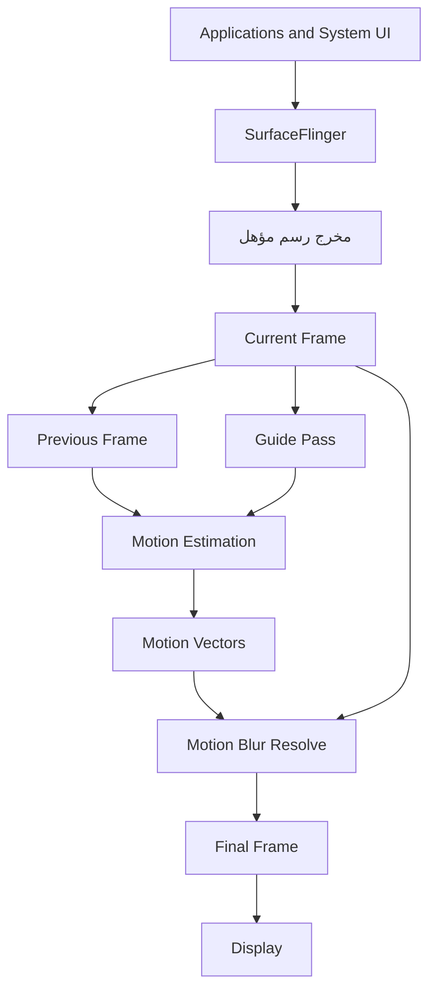

# How Skia Motion Blur works

## نظرة عامة

تضيف Skia Motion Blur تأثير ضبابية الحركة (Motion Blur) إلى مخارج رسم مؤهلة داخل نظام العرض في أندرويد.

تعتمد الوحدة على تحليل الاختلافات بين الإطارات المتتالية لتقدير اتجاه حركة العناصر ومقدارها. تستخدم هذه المعلومات لإضافة ضبابية تتناسب مع الحركة قبل عرض الصورة النهائية على الشاشة.

لا تنشئ الوحدة إطارات جديدة ولا ترفع معدل الإطارات (FPS). الهدف هو تحسين المظهر البصري للحركة وجعلها تبدو أكثر سلاسة وطبيعية.

## أين تعمل الوحدة داخل أندرويد؟

تعمل الوحدة داخل SurfaceFlinger وهو المكون المسؤول عن تجميع الطبقات الرسومية القادمة من التطبيقات وواجهة النظام لإنتاج الصورة النهائية التي تظهر على الشاشة.

تُعرف هذه العملية باسم التركيب الرسومي (Composition).

يستخدم SurfaceFlinger مكونات رسومية لتنفيذ عمليات التركيب التي تحتاج إلى المعالج الرسومي (GPU).

تتدخل الوحدة في مسار الرسم المدعوم لإضافة مرحلة معالجة رسومية قبل عرض الصورة النهائية.

يسمح هذا الأسلوب بتطبيق التأثير على مستوى النظام دون الحاجة إلى تعديل التطبيقات أو الألعاب بشكل منفصل.

## مراحل المعالجة

تمر الصورة بعدة مراحل لتحديد الحركة وإنتاج تأثير الضبابية.

### 1. الاحتفاظ بالإطار السابق (Frame History)

تحتفظ الوحدة بنسخة من الصورة السابقة داخل ذاكرة المعالج الرسومي.

تُستخدم هذه الصورة كمرجع عند وصول صورة جديدة لتحديد التغيرات التي حدثت بين الإطارين.

يمكن الاحتفاظ بنسخة مصغرة من الصورة بدلًا من استخدام دقتها الكاملة لتقليل حجم البيانات المطلوبة لتحليل الحركة.

### 2. تحليل تفاصيل الصورة (Guide Pass)

تُجهز الوحدة معلومات بصرية تساعد على مقارنة الإطار الحالي بالإطار السابق.

تساعد هذه المرحلة على تمييز التفاصيل والاختلافات داخل الصورة وتحسين عملية البحث عن المناطق التي تغير موقعها.

الهدف هو توفير معلومات مناسبة لمرحلة تقدير الحركة دون الحاجة إلى إجراء جميع الحسابات على الصورة الأصلية بدقتها الكاملة.

### 3. تقدير الحركة (Motion Estimation)

تقارن الوحدة الإطار الحالي بالإطار السابق لتقدير كيفية انتقال التفاصيل بينهما.

تنتج هذه العملية معلومات تُعرف باسم متجهات الحركة (Motion Vectors).

يحتوي متجه الحركة على معلومات تمثل:

- الاتجاه الأفقي للحركة.
- الاتجاه العمودي للحركة.
- مقدار الإزاحة بين الإطارين.

على سبيل المثال عند تمرير صفحة إلى الأعلى تحاول الوحدة اكتشاف انتقال النصوص والصور من مواقعها السابقة إلى مواقعها الجديدة.

يمكن أن تختلف متجهات الحركة من منطقة إلى أخرى داخل الصورة. يسمح ذلك بتقدير حركة عناصر متعددة تتحرك في اتجاهات مختلفة.

### 4. حساب الضبابية (Motion Blur Resolve)

تستخدم الوحدة متجهات الحركة لتحديد اتجاه الضبابية وطول أثرها.

تُجمع عدة عينات لونية (Samples) من الصورة على امتداد اتجاه الحركة ثم تُدمج لإنتاج تأثير الضبابية.

تحتاج المناطق التي تتحرك بسرعة إلى أثر ضبابية أطول عادة من المناطق التي تتحرك ببطء.

تحاول الوحدة الحفاظ على وضوح المناطق الثابتة وتجنب إضافة ضبابية غير ضرورية إليها.

تُنفذ هذه العمليات باستخدام برامج رسومية صغيرة تُعرف باسم Shaders وتعمل على المعالج الرسومي.

### 5. عرض الصورة النهائية

بعد حساب الضبابية تُدمج النتيجة مع الصورة الحالية ضمن مسار الرسم.

تستمر الصورة بعد ذلك عبر نظام العرض في أندرويد حتى تظهر على الشاشة.

تتكرر هذه المراحل مع الإطارات الجديدة التي يمكن للوحدة معالجتها.

## مسار المعالجة الرسومية

يوضح المخطط التالي المراحل الأساسية لعمل الوحدة.

## كيف تكتشف الوحدة الحركة؟

لا تعتمد الوحدة على حركة الإصبع لتحديد اتجاه الضبابية.

تعتمد بشكل أساسي على التغيرات البصرية بين الإطارات المتتالية باستخدام تقدير الحركة المستند إلى الصورة (Image-based Motion Estimation).

يسمح ذلك باكتشاف الحركة الناتجة عن التمرير أو الرسوم المتحركة أو تشغيل الفيديو دون الحاجة إلى لمس الشاشة.

يمكن أن يساعد لمس الشاشة على ظهور الضبابية مع الحركات الصغيرة لفترة قصيرة، لأنه يخفض الحد المطلوب لتطبيق الأثر. لا يحدد اللمس اتجاه الحركة.

## كيف تقلل الوحدة استهلاك الموارد؟

تتطلب عملية تقدير الحركة مقارنة عدد كبير من البكسلات بين الإطارات المتتالية.

عند اختيار `history_scale` بقيمة أكبر من `1`، تقلل الوحدة دقة صور المعالجة لتخفيف تكلفة هذه العملية. القيمة الافتراضية `1` تستخدم الدقة الكاملة.

يعتمد هذا الأسلوب على إنشاء نسخ مصغرة من الصور المستخدمة في تحليل الحركة. يساعد ذلك على تقليل حجم البيانات وعدد العمليات الحسابية المطلوبة.

يوضح الجدول التالي مثالًا على أحجام صور التحليل عند استخدام شاشة بدقة 1080 × 2400 بكسل.

| دقة التحليل | حجم صورة التحليل | نسبة عدد البكسلات |
|---|---:|---:|
| 100% | 1080 × 2400 | 100% |
| 50% | 540 × 1200 | 25% |
| 33.3% | 360 × 800 | 11.1% |
| 25% | 270 × 600 | 6.25% |

على سبيل المثال يؤدي استخدام 25% من دقة العرض والارتفاع إلى تحليل 6.25% فقط من إجمالي عدد البكسلات.

يساعد ذلك على تقليل حجم الصور المخزنة وتخفيف الحمل الناتج عن تحليل الحركة.

لكن انخفاض دقة التحليل قد يجعل اكتشاف الحركات الصغيرة والتفاصيل الدقيقة أكثر صعوبة.

لا يؤثر تقليل دقة التحليل على دقة الشاشة نفسها. تُدمج نتيجة الضبابية مع مخرج الرسم المؤهل بدقة إخراجه.

## استخدام المعالج الرسومي

تعتمد الوحدة على المعالج الرسومي لتنفيذ العمليات الأساسية المتعلقة بتحليل الحركة وحساب الضبابية.

تُخزن الصور المستخدمة في المعالجة داخل موارد رسومية تُعرف باسم Textures.

تُستخدم برامج Shaders لتنفيذ العمليات الحسابية على هذه الصور والاستفادة من قدرة المعالج الرسومي على معالجة عدد كبير من البكسلات بالتوازي (Parallel Processing).

يساعد هذا الأسلوب على تقليل الحاجة إلى نقل بيانات الصور بين المعالج المركزي والمعالج الرسومي.

مع ذلك تظل المعالجة بحاجة إلى وقت إضافي وذاكرة وموارد رسومية.

## اختيار مسار الرسم

تختار الوحدة مسار المعالجة تلقائيًا حسب قدرات OpenGL ES وامتدادات تعريف الرسوميات.

تستخدم مرحلة تقدير الحركة العام Compute Shader عند توفر الدعم ونجاح تجميعه، أو Fragment Shader عند تعذر استخدامه. تبقى مراحل أخرى من المعالجة رسومية أيضًا.

عند `history_scale=2–4` تستخدم الوحدة Framebuffer Fetch إذا كان مدعومًا وكان مخرج الرسم غير متعدد العينات. وإلا تستخدم نسخة منفصلة من الصورة.

عند `history_scale=1` يُرسم التأثير بدقة الإخراج مباشرة.

يمكن معرفة المسارات المستخدمة من حقلي `guide` و`composite` في ملف حالة GLES.

## لماذا قد تؤثر الوحدة على الأداء؟

تضيف الوحدة مراحل معالجة رسومية إلى مسار عرض الصورة في أندرويد.

تشمل هذه المراحل:

- تخزين الإطارات السابقة.
- تجهيز الصور المستخدمة لتحليل الحركة.
- حساب متجهات الحركة.
- قراءة العينات اللونية وحساب الضبابية.
- دمج النتيجة مع الصورة الحالية.

تعتمد تكلفة هذه العمليات على عدة عوامل مثل قوة المعالج الرسومي ودقة الشاشة وسرعة الذاكرة وعدد العينات المستخدمة في حساب الضبابية.

تحاول الوحدة تقليل هذه التكلفة مع الحفاظ على جودة التأثير قدر الإمكان.

## الفرق بين ضبابية الحركة وتوليد الإطارات

تختلف ضبابية الحركة (Motion Blur) عن توليد الإطارات (Frame Generation) رغم أن كليهما يهدف إلى تحسين تجربة مشاهدة الحركة.

| التقنية | طريقة العمل |
|---|---|
| Motion Blur | تعديل الإطارات الموجودة لإضافة أثر بصري باتجاه الحركة. |
| Frame Generation | إنشاء إطارات إضافية بين الإطارات الأصلية. |

تعمل Skia Motion Blur على تحسين المظهر البصري للإطارات الموجودة دون إنشاء إطارات إضافية.

قد تبدو الحركة أكثر سلاسة عند استخدام الضبابية رغم بقاء معدل الإطارات كما هو.

## حدود تقدير الحركة

تعتمد الوحدة على المعلومات البصرية الموجودة داخل الإطارات ولا تحصل على متجهات الحركة الأصلية من محركات الألعاب أو التطبيقات.

تُحسب متجهات الحركة من خلال مقارنة الصور بدلًا من الاعتماد على المواقع الحقيقية للعناصر داخل المشهد.

لهذا السبب قد تواجه عملية تقدير الحركة بعض الصعوبات في حالات مثل:

- الحركة السريعة جدًا.
- تغير المشهد بالكامل بين إطارين.
- ظهور عناصر جديدة أو اختفاء عناصر موجودة.
- وجود عناصر شفافة أو تفاصيل متشابهة.
- تحرك عدة عناصر متداخلة في اتجاهات مختلفة.

قد تؤدي هذه الحالات إلى تقدير غير دقيق للحركة أو ظهور بعض الآثار البصرية غير المرغوبة (Visual Artifacts).

تعتمد جودة النتيجة النهائية على دقة تقدير الحركة وطبيعة المحتوى المعروض.
