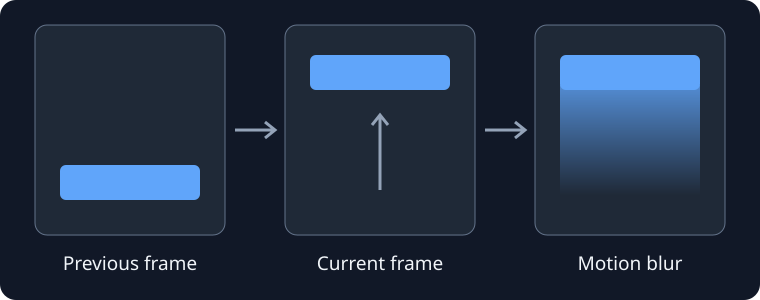
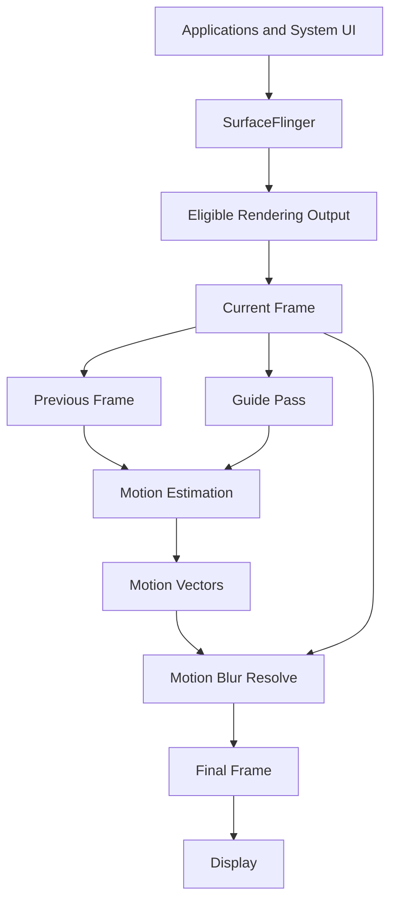
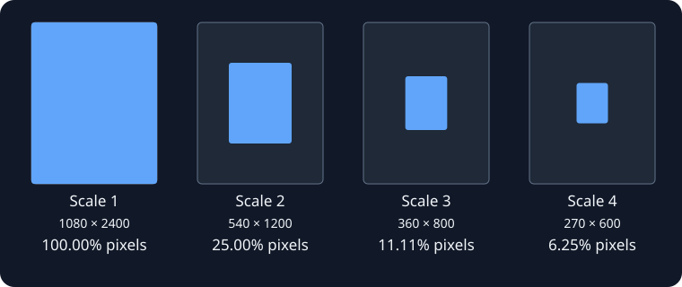

# How Skia Motion Blur works

## Overview

Skia Motion Blur adds a motion blur effect to eligible rendering outputs within the Android display system.

The module analyzes differences between consecutive frames to estimate the direction and magnitude of object movement. It uses this information to add blur that corresponds to the motion before displaying the final image on the screen.

The module does not generate new frames or increase the frame rate (FPS). The goal is to improve the visual appearance of motion and make it look smoother and more natural.

## Where does the module operate within Android?

The module operates within SurfaceFlinger, the component responsible for combining graphics layers from applications and the system UI to produce the final image displayed on the screen.

This process is known as Composition.

SurfaceFlinger uses graphics components to perform composition operations that require the graphics processing unit (GPU).

The module intervenes in the supported rendering path to add a graphics processing stage before displaying the final image.

This approach allows the effect to be applied at the system level without modifying individual applications or games.

## Processing Stages

The image goes through several stages to determine motion and produce the blur effect.

### 1. Frame History

The module keeps a copy of the previous image in GPU memory.

This image is used as a reference when a new image arrives to identify the changes that occurred between the two frames.

A downscaled copy of the image can be stored instead of using its full resolution to reduce the amount of data required for motion analysis.

### 2. Guide Pass

The module prepares visual information that helps compare the current frame with the previous frame.

This stage helps distinguish details and differences within the image and improves the process of searching for regions that have changed position.

The goal is to provide suitable information for the motion estimation stage without having to perform all calculations on the original image at its full resolution.

### 3. Motion Estimation

The module compares the current frame with the previous frame to estimate how details have moved between them.

This process produces information known as Motion Vectors.

A motion vector contains information representing:

- The horizontal direction of motion.
- The vertical direction of motion.
- The amount of displacement between the two frames.

For example, when scrolling a page upward, the module attempts to detect the movement of text and images from their previous positions to their new positions.

Motion vectors can vary from one region of the image to another. This allows the module to estimate the motion of multiple objects moving in different directions.

### 4. Motion Blur Resolve

The module uses motion vectors to determine the direction of the blur and the length of its trail.

Multiple color samples are collected from the image along the direction of motion and then combined to produce the blur effect.

Fast-moving regions usually require a longer blur trail than slow-moving regions.

The module attempts to preserve the clarity of stationary regions and avoid adding unnecessary blur to them.

These operations are performed using small graphics programs known as Shaders that run on the GPU.

### 5. Final Image Display

After calculating the blur, the result is blended with the current image within the rendering path.

The image then continues through the Android display system until it appears on the screen.

These stages are repeated with new frames that the module can process.

## Graphics Processing Pipeline

The following diagram illustrates the main stages of the module's operation.

## How does the module detect motion?

The module does not rely on finger movement to determine the direction of the blur.

It primarily relies on visual changes between consecutive frames using Image-based Motion Estimation.

This allows it to detect motion caused by scrolling, animations, or video playback without requiring screen touches.

Touching the screen can help the blur appear with small movements for a short period, as it lowers the threshold required to apply the effect. Touch input does not determine the direction of motion.

## How does the module reduce resource usage?

Motion estimation requires comparing a large number of pixels between consecutive frames.

When `history_scale` is set to a value greater than `1`, the module reduces the resolution of the processing images to lower the cost of this operation. The default value of `1` uses full resolution.

This approach relies on creating downscaled copies of the images used for motion analysis. This helps reduce the amount of data and the number of calculations required.

The following table shows an example of analysis image sizes when using a screen with a resolution of 1080 × 2400 pixels.

| Analysis Resolution | Analysis Image Size | Pixel Count Percentage |
|---|---:|---:|
| 100% | 1080 × 2400 | 100% |
| 50% | 540 × 1200 | 25% |
| 33.3% | 360 × 800 | 11.1% |
| 25% | 270 × 600 | 6.25% |

For example, using 25% of the width and height resolution results in analyzing only 6.25% of the total pixel count.

This helps reduce the size of stored images and lower the workload caused by motion analysis.

However, reducing the analysis resolution may make detecting small movements and fine details more difficult.

Reducing the analysis resolution does not affect the screen resolution itself. The blur result is blended with the eligible rendering output at its output resolution.

## GPU Usage

The module relies on the GPU to perform the main operations related to motion analysis and blur calculation.

The images used for processing are stored in graphics resources known as Textures.

Shaders are used to perform calculations on these images and take advantage of the GPU's ability to process a large number of pixels in parallel (Parallel Processing).

This approach helps reduce the need to transfer image data between the CPU and GPU.

However, processing still requires additional time, memory, and graphics resources.

## Rendering Path Selection

The module automatically selects the processing path based on OpenGL ES capabilities and graphics driver extensions.

The general motion estimation stage uses a Compute Shader when supported and successfully compiled, or a Fragment Shader when it cannot be used. Other processing stages also run on the GPU.

When `history_scale=2–4`, the module uses Framebuffer Fetch if supported and the rendering output is not multisampled. Otherwise, it uses a separate copy of the image.

When `history_scale=1`, the effect is rendered directly at the output resolution.

The paths being used can be identified through the `guide` and `composite` fields in the GLES status file.

## Why might the module affect performance?

The module adds graphics processing stages to the Android image display pipeline.

These stages include:

- Storing previous frames.
- Preparing images used for motion analysis.
- Calculating motion vectors.
- Reading color samples and calculating blur.
- Blending the result with the current image.

The cost of these operations depends on several factors, such as GPU performance, screen resolution, memory speed, and the number of samples used for blur calculation.

The module attempts to reduce this cost while maintaining the quality of the effect as much as possible.

## The Difference Between Motion Blur and Frame Generation

Motion Blur differs from Frame Generation, although both aim to improve the motion viewing experience.

| Technique | How It Works |
|---|---|
| Motion Blur | Modifies existing frames to add a visual effect in the direction of motion. |
| Frame Generation | Creates additional frames between the original frames. |

Skia Motion Blur improves the visual appearance of existing frames without generating additional frames.

Motion may appear smoother when using blur even though the frame rate remains unchanged.

## Motion Estimation Limitations

The module relies on visual information within the frames and does not obtain original motion vectors from game engines or applications.

Motion vectors are calculated by comparing images rather than relying on the actual positions of objects within the scene.

For this reason, motion estimation may encounter difficulties in situations such as:

- Very fast motion.
- Complete scene changes between two frames.
- New objects appearing or existing objects disappearing.
- Transparent objects or similar details.
- Multiple overlapping objects moving in different directions.

These situations may result in inaccurate motion estimation or unwanted visual effects (Visual Artifacts).

The quality of the final result depends on the accuracy of motion estimation and the nature of the displayed content.